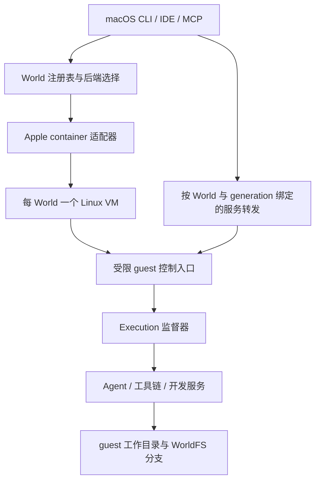

# macOS 宿主上的 Linux World

状态：设计与实验实现。决策日期：2026-10-25。已实现的范围见下节，其余章节仍是目标设计，不能当作已交付能力。本文定义用户明确选择 Linux 执行环境时的本地后端，与原生 macOS Workspace 并存。

## 当前实验实现

代码入口为 `crates/world-runtime/src/apple_vm.rs`、`guest/supervisor.py` 与 CLI 的 `--os` 选择。已实现：

- macOS / arm64 + 显式 `--os linux` 选择 VM，原生工作流保持不变；一个 World 一个 VM。
- create 保存配置和初始生命周期阶段；setup 创建/启动并检查 guest 协议与 cgroup.kill；show/list 返回配置、生命周期、provider 观测、时间和错误；exec 显式要求 ready；teardown 停机保留可写层；delete 仅删除已停机且归属匹配的 VM 实例与登记。
- 允许 container 1.6.1、1.7.1，固定 Python/Alpine 镜像 digest，guest `/workspace`、UID/GID 1000、独立 cgroup v2、no_new_privs。argv/标准输入/退出码透传；正常结束、超时与取消均清理同一任务的后代，包括 setsid 后代。
- `workspace import <world> --source <host-directory>` 将宿主目录复制到空 guest `/workspace`。先以目录 fd 和 openat/O_NOFOLLOW 遍历，生成宿主磁盘上的有界流记录快照；guest 校验文件长度、结束标记、相对路径与父目录，拒绝 symlink 父目录、重复路径和特殊文件，暂存完成后原子替换空目录。导入与 exec/setup/teardown 使用独占锁互斥。源变化检测是尽力检查，源应暂停写入，不宣称一致性快照。
- 同一 VM 的并发 exec 共享 localhost，任务间取消独立。每个任务的结果保存于 guest `/var/lib/world/executions`；启动前向 stderr 输出随机 Execution ID，重试命令不复用已执行 ID。尚无公共 execution 查询/日志 API，断线时可能返回 unknown，不自动重放。
- 原生与 VM 记录共用原子注册表，原生条目保持旧格式，VM 条目标注 schema_version=2；首次加入 VM 前备份已有注册表。原生更新保留 VM 条目，重复名称禁止跨后端覆盖。旧二进制会因无法解析 VM 条目拒绝整个混合注册表；不能自动退回备份。

这是一版用于验证路径的实现，和下面目标设计的差距需要明确：

| 项目 | 当前行为 |
| --- | --- |
| 网络安全策略 | 默认 provider NAT。显式离线模式只启用 guest loopback。按目的地限制的互联网出口仍待实现 |
| 运行预算 | 每用户 setup 准入锁。默认单 VM。离线 World 可显式指定总内存预算，准入会核对 provider 的活跃实例和配置内存 |
| 数据与镜像 | guest 普通可写层，无宿主挂载；固定基础镜像加 root-owned helper；支持独立 import 和 export 命令；无创建时 --import、自定义镜像、WorldFS、分支合并 |
| 服务 | Linux VM 已支持命名服务、独立 cgroup、状态和有界日志，支持宿主 IPv4 loopback TCP 发布。普通 exec 结束仍会清理后台子进程 |
| 生命周期 | setup/teardown 与 exec 用文件锁互斥；teardown 遇活跃执行返回 busy，不能自动批量取消；已落盘阶段和启动 generation；尚无完整 Execution 恢复日志 |
| 协议 | 固定 helper 命令与独立 JSON 状态查询；不是完整 RPC/PTY/输出持久化协议；guest 控制进程故障后状态可能未知，需检查或停机 |
| 安全级别 | 实验性 VM 执行边界，不是设计中的受管安全后端；未交付的出口策略不会被描述为有效 |

导入保留内容、普通权限、可执行位和符号链接（包括悬空链接），移除 setuid/setgid/sticky 位，所有权设为 guest UID/GID 1000。隐藏文件和未跟踪文件默认包含；不保留时间戳、xattr、ACL、稀疏布局或硬链接关系。非 UTF-8 名称/链接目标、设备节点、FIFO、socket、超过 128 层的目录、超过一百万个条目及超过 4096 字节的相对路径明确失败。快照临时文件需要与源数据规模相当的宿主磁盘空间，传输记录有界，不将整个项目放入内存。guest 文件逐个 fsync，发布后同步父目录；不承诺磁盘崩溃下所有目录项的事务持久性。

取消信号在快照完成、传输开始前生效；传输开始后等待确定结果，上限 10 分钟，避免只关闭客户端就错误报告“未导入”。传输断线/超时返回结果未知，重试前先检查 `/workspace`；guest 的正常失败会清理暂存目录，VM 崩溃可能留下 `/var/lib/world/imports` 中的暂存数据，暂未自动回收。导入要求结束正在执行的命令并停止常驻服务。已有内容始终不自动覆盖。旧 VM 在无活跃 exec 时执行 setup，可原子更新 guest helper 后使用 import。

宿主本地用户仍能直接用 container 管理自己的 VM，这属于受信任宿主权限范围。旧记录不做全库 schema 转换；完整注册表/host identity/运行代际迁移后续再实现。OS 不匹配、provider 不可用或版本不兼容时拒绝 exec，不回退到宿主。

实际命令见 [README](../README.md#macos-上运行-linux-world实验性)。真实单 VM 回归用 `python3 experiments/macos/world_vm_smoke.py`：先 `cargo build --workspace` 并启动 container 服务；脚本以 512 MiB 工作负载限额启动一个 VM，在临时目录记录结果，退出时停止并删除自己的实例，保留服务与镜像缓存。覆盖同名冲突、执行前置状态、stdin/argv、非零状态、后代回收、超时/取消、共享 localhost、独立任务取消、busy teardown、导入及重启持久化；导入覆盖跨块二进制内容、执行权限、相对与悬空链接、截断流、路径越界、symlink 父目录、特殊文件和覆盖拒绝。该测试只启动一个 VM，不声称完成跨 VM 网络策略验收。

### 导出项目文件

```sh
world workspace export dev --destination ./results
```

导出从已就绪 VM 的 `/workspace` 读取文件。目标目录必须尚不存在，父目录必须已存在。活跃的 `world exec` 或命名服务会让导出失败。导出期间 World 持有 Workspace 独占锁，直接通过 provider 启动的写入者也需要先停写。这是文件级复制，源变化检测为尽力检查。

导出包含隐藏文件、空目录、普通权限和符号链接。它不跟随符号链接，拒绝特殊文件与非 UTF-8 名称，且不保留扩展属性、ACL、时间戳和硬链接关系。宿主验证完整文件流与 guest 退出状态后，才将暂存目录原子发布到目标。已存在的目录、文件或符号链接会保留原样，取消或校验失败不发布半成品。

### 实验性 guest 服务

```sh
world service start dev web -- python3 -u -m http.server 3000 --bind 127.0.0.1
world service list dev
world service show dev web
world service logs dev web --stream stderr
world service restart dev web
world service stop dev web
world service remove dev web
```

服务使用 UID 1000 和独立 cgroup，工作目录为 `/workspace`，在发起命令退出后继续运行。日志查询返回所选流最新 64 KiB 的 base64，旧日志有大小上限。停止和 teardown 清理整个服务 cgroup。VM 再次启动时保留服务定义，不自动启动服务。写操作在发送前打印 operation ID，`world service operation dev <id>` 可查询 24 小时内的结果，`--request-id <id>` 可重试同一请求。日志 follow 和优雅停止待实现。

### 发布 TCP 端口

```sh
world service publish dev web --name browser --host-port 13000 --target-port 3000
world service ports dev web
world service unpublish dev web --name browser
```

发布后可从 Mac 访问 `http://127.0.0.1:13000`。guest 服务可以继续只监听 `127.0.0.1:3000`。当前每个 World 支持一个发布，宿主端口为 1024～65535，只支持 IPv4 loopback TCP。端口被占用时命令失败。发布成功表示转发通道可用，应用就绪仍由应用决定。从旧版本升级时，运行中的监督器可能尚未更新。若提示监督器缺少发布能力，先停机再执行 setup。

一个宿主 broker 和一条 guest 通道最多复用八个活跃连接，每条连接每方向最多有一块 8 KiB 的应用数据等待确认。撤销和停机会关闭监听与连接。发布绑定当前服务 run，服务改变或通道断开后需显式重新发布。broker 退出时释放监听端口，发布配置不跨 broker 重启恢复。

## 已实现的生命周期管理

- `workspace list` 返回所有本地登记；原生记录标为 `unobserved`，不凭 loopback 地址推断进程存活。VM 的本地配置始终保留在查询结果中，provider/版本/归属校验失败返回 `unknown` 与 `observation_error`。
- `workspace show` 的 VM 状态区分 `created`（尚未创建实例）、`ready`（实例运行，且 guest boot ID 与最近一次 setup 的记录一致）、`unverified`（实例存在，但本地阶段、guest boot ID 或 provider 状态尚未确认）、`stopped`、`missing`（此前已尝试创建/运行、现在确认不存在）和 `deleting`。forkfs workspace 也会在查询时检查挂载，失败时报告 `storage_unavailable`。exec 每次启动前重新验证。`lifecycle.phase` 返回最后持久化的操作阶段，`observed_at_unix` 是本次观测时间，generation 在每次尝试启动前递增。若 provider 已在 World 外重启 VM，setup 验证并登记新 boot ID 时递增；同一次启动上的幂等 setup 保持原代际。旧记录缺少 boot ID 时需先执行 setup。
- 阶段记录按 instance owner 单独原子持久化，包含 created/provisioning/starting/ready/stopping/stopped/deleting。中断操作保留阶段用于后续检查；缺日志的旧记录视为 legacy，存在的实例可通过 setup 重新验证，缺失的实例不会被默认为从未创建。
- setup 发现旧运行时缺失或首次创建是否成功无法确认时拒绝隐式新建。只有 `--recreate-missing` 显式允许在确认实例不存在时创建空运行时；存在的实例始终复用，不能用该选项覆盖。VM 可写层文件随原实例丢失。已绑定 forkfs 的 workspace 会重新挂载原分支。
- teardown 保留注册和数据，不触发 WorldFS discard。活跃 exec/import 与其锁互斥，返回 busy，调用者应先取消执行。provider 不可用时不改写已知阶段；停止结果未知时保留 stopping，重试前重新观测。
- `workspace delete <name>` 要求没有活跃执行、provider 可查询，实例已 stopped/created，owner/image 匹配且 mounts 为空。有实例时必须指定 `--discard-runtime-data`，明确授权永久删除其可写层；尚未创建或确认丢失的实例可仅删除登记。原生 Workspace 暂不支持 delete。
- 删除先落盘 deleting，再删除 provider 实例，确认不存在后原子移除登记；任何 provider 错误保留登记，重复 delete 可完成收尾。deleting 阶段拒绝 setup/exec/import/同名 create。小型 journal/锁文件保留为 tombstone，避免旧句柄复活。所有操作取得锁后重新检查登记 owner，防止删除后同名重建的竞争。

带 provider 挂载的实例拒绝删除。forkfs workspace 删除前需结束挂载 worker，分支保留在仓库中。尚未实现公共 Execution 查询/日志恢复、完整操作错误日志、跨 provider 恢复或自动 setup。

真实单 VM 回归追加验证：list、ready/stopped/created/missing/unknown 状态、幂等 setup 不推进 generation、重启推进 generation、删除运行 VM 拒绝、无数据删除确认拒绝、外部删除后的隐式重建拒绝与显式重建、删除 VM 保留同注册表原生记录，以及删除未创建实例的登记。单元测试覆盖 deleting 阶段防复活和同名替换后的旧句柄拒绝。

## 1. 决策与适用范围

**当 `execution_os=linux` 且 `host_os=macos` 时，选择 `apple-container`：一个 World 对应一个持久的轻量 Linux VM。** 用户选择操作系统，World 选择匹配且经过验证的执行后端。首版只支持 Apple Silicon 上的 Linux arm64；不隐式使用 Rosetta，不提供 Linux guest 内执行宿主命令的逃生通道。

| 宿主 | 用户选择的执行 OS | 解析结果 |
| --- | --- | --- |
| macOS / arm64 | linux | `apple-container`，一个 World 一个 VM |
| macOS | macos | 现有原生 Silo 兼容后端，保留其限制 |
| Linux | linux | 现有 Linux namespace 后端 |
| 任意宿主 | 未指定 | 新建时解析为宿主 OS 并持久化；不自动选择 Linux |
| Linux | macos | 拒绝，不以 Linux 冒充 macOS |
| macOS / Intel、Windows 或未支持组合 | linux | 首版明确不支持，不自动安装其他 VM 后端 |

“持久”指 Workspace 身份、磁盘与配置持久；VM 进程可以停止。每次 `exec` 复用该 World 的 VM，多次命令共享服务。首版不采用共享 VM 承载多个 World，也不为每条命令创建 VM。Xcode、Apple SDK 和原生 macOS 测试继续使用 macOS World。

本设计替代此前对所有 macOS 场景施加的“不依赖 Linux VM”约束。原生 macOS 的注入兼容性调查仍有效，但不阻塞 Linux World。

## 2. 实测依据与资源预算

[可重复探针](../experiments/macos/linux_vm_probe.py)和[2026-10-25 实测记录](../experiments/macos/linux_vm_probe_result_2026-10-25.json)来自 8 GiB Apple Silicon、macOS 27.0.1、Apple container 1.6.1、Linux 6.18.35、Alpine 3.22：

| 项目 | 结果与含义 |
| --- | --- |
| 配置 | 1 CPU、256 MiB 工作负载内存限额；不是宿主总占用上限 |
| 缓存齐全的创建启动 / 重启 | 0.616 / 0.517 秒，单次轻负载样本 |
| 宿主 physical footprint | VM 与专属 runtime 约 286 MiB；共享后台服务另约 26 MiB |
| 初始化成本 | 较早首次启动包含运行时初始化，耗时 21.388 秒；API server 历史内存峰值约 709.5 MiB |
| 已验证 | 多次 exec 访问同一 localhost 服务、重启保留文件、user/net/mount namespace 创建 |
| 未验证 | World 二进制、Agent、构建吞吐、pasta、完整隔离策略、forkfs、宿主端口转发 |

测量支持低成本单 VM 的可行性，不能据此推算十个 Agent 的成本。软件仓库下载未完成，不能把本次测试算作包管理网络验收。VM 重启后服务进程不恢复，需要重新启动。

产品初始默认拟定为 1 CPU、512 MiB 工作负载限额，允许用户显式设为 256 MiB 做小型任务；这些是产品预算，不是实测最佳值。8 GiB 宿主默认最多同时运行一个 Linux VM，其他 World 保持 stopped；达到上限返回资源不足，不停止已有 World，也不静默排队。提供宿主级并发上限配置和每 World 资源配置，扩容在停止后生效。

内存准入同时考虑配置限额、运行时余量及宿主内存压力，不把 macOS “free” 页面当作可分配容量，也不承诺硬性限制整个宿主物理占用。OOM 返回可识别的失败及 guest 证据；不能仅凭退出码 137 推断 OOM。首版不做自动扩容、热池或自动闲置停机，避免误杀后台服务。UI 分别显示工作负载限额、guest 用量与宿主占用，初始化下载峰值单列。

## 3. 用户接口与持久模型

以下展示目标接口：`--os`、`--cpus`、`--memory` 及基本生命周期已实现；`--import` 尚未实现：

```sh
# 新建空的 guest 工作目录；镜像由版本锁定的 World Linux 开发镜像提供。
world workspace create dev --os linux --cpus 1 --memory 512M
# 或显式将宿主目录导入为初始内容，不建立双向共享。
world workspace create app --os linux --import ./project --cpus 1 --memory 512M
world workspace setup dev
world workspace show dev
world exec dev -- uname -a
world exec dev -- sh -lc 'cd /workspace && make test'
world workspace teardown dev
```

- `--os` 取 `linux|macos`，创建时解析并持久化，执行时不能覆盖；改变 OS 必须新建 World 并显式迁移内容。
- 原生 Workspace 保留 `--workdir` 绑定已有宿主目录的语义。VM Workspace 使用固定 guest 工作目录 `/workspace`，拒绝 `--workdir`，以免同一参数暗中变成拷贝。`--import` 的宿主源路径只用于首次导入；不能在 guest 解释 `/Users/...`。
- VM 的 `create` 只登记配置及待导入源；`setup` 首次执行导入，成功前不接受任务。源可能变化，所以导入记录内容清单与实际完成 revision，后续 setup 不重新同步。需调用者保持源稳定，检测到变化时失败并重试，不承诺任意活跃目录的原子快照。
- `--image` 为后续高级选项；首版使用携带匹配协议版本的固定镜像 digest，不接受任意 OCI 镜像假装具有 World 管理能力。内核与 init 镜像也记录版本/digest，升级不自动替换已有 World 的运行契约。
- `setup` 幂等创建或启动；`exec` 要求 ready，不隐式下载、启动或变更 OS。`teardown` 仅停止此 World 的执行与 VM，保留可写层及工作数据；不调用全局 `container system stop`。
- `show` 返回期望配置与实际观测，至少包含宿主 OS、执行 OS/架构、后端、运行状态、generation、镜像/内核版本、资源限额、guest 路径、能力状态与观测时间。CLI 输出与 JSON 使用相同事实。

建议版本化 Workspace 记录：

```json
{
  "schema_version": 2,
  "id": "<stable-world-id>",
  "execution": { "os": "linux", "arch": "arm64" },
  "runtime": {
    "backend": "apple-container",
    "host_id": "<local-host-id>",
    "instance_id": "<provider-container-id>",
    "generation": 1,
    "image_digest": "sha256:<locked-image-digest>",
    "cpus": 1,
    "memory_bytes": 536870912
  },
  "storage": { "mode": "guest-managed", "workdir": "/workspace" }
}
```

示例仅展示核心字段；真实记录另含名称、desired/observed 状态、导入与 Operation 日志、协议版本、kernel/init 标识、能力探测结果及存储引用。host OS 是探测结果，不能信任用户自报。VM 后端不需要原生 `ip`/`temp_root` 字段，采用带标签的后端专属结构，不填假值。

现有 `silo::World` 使用 `deny_unknown_fields`，必须先引入显式 schema 版本与平台无关注册表，不能直接在旧 JSON 中追加字段。升级在锁内备份并原子迁移；缺少 OS 的旧记录按本机原生后端迁移，不转换成 VM。旧状态来源无法确定时拒绝自动迁移；原有 `--state-dir`、registry 身份、holder 与临时目录关联保持不变。旧二进制读取新版状态必须失败，禁止丢字段写回。跨宿主复制注册表不构成迁移。

## 4. 组件与执行路径



职责分为三层：

1. World 宿主侧管理身份、期望配置、幂等操作、后端选择、预算、端口发布和恢复。
2. Apple container 提供镜像、VM、网络设备与可写 rootfs 生命周期。首版适配固定兼容版本的 CLI，通过参数数组调用，读取 `inspect` 等结构化 JSON，不解析人类表格，不通过 shell 拼接命令。将供应商调用集中在一个模块，未来可替换为 Swift helper / Containerization API，公共接口不变。
3. guest 控制入口验证 World ID、generation 和协议版本，管理任务的退出状态、取消、输出及文件传输。控制通道首版通过 `container exec` 启动固定 helper，以 stdin/stdout 承载有长度上限的版本化消息；不用开放 TCP 管理端口。任务输出与协议帧分离，argv 不拼成 shell 字符串，用户环境不能覆盖管理身份。

宿主调用 `container exec` 的权限属于本地宿主信任边界；VM 中的普通任务不得获得控制凭证、管理 socket 或修改 helper 的权限。任务默认以非 root 身份运行，管理入口及状态受 guest 权限保护。缺少身份握手或版本不兼容时不执行用户命令。初始化与安装开发镜像依赖由受信启动过程完成，不默认赋予任务 sudo/CAP_NET_ADMIN。

未接入 forkfs 的本地运行时阶段，由 guest Execution 监督器执行命令，这是现有本地 Workspace 模式的 VM 扩展。接入第 10 节受管 forkfs 路线后，执行和存储锁的唯一所有者改为 guest 中的 forkfs RPC 服务；guest 控制入口仅承载/转接该 RPC，不再维护第二套 Execution。受管路径保持现有组织、Network、StoreBinding 与授权要求，不因 VM 在本机而降级为匿名执行。

不能把宿主 macOS 编译的 `world` 放进 guest 运行；发布 Linux arm64 的 helper/worker 与匹配开发镜像。一个 VM 已有独立内核与网络栈，首版无需再用 pasta 为 World 创建第二层网络。复用 Linux 进程监督与策略模块按能力进行，不直接嵌套整套 `silo::setup`。Agent 内层 sandbox 的网络 namespace 仍需单独验收。

## 5. 生命周期、执行与恢复

运行状态使用 `created → provisioning → stopped → starting → ready → stopping → stopped`，另有 `failed` 与 `unknown`。它与 WorldFS 的 ACTIVE/TRASHED 等存储状态独立，不把停机当作 discard。

| 动作 / 事件 | 契约 |
| --- | --- |
| 首次 setup | 锁定 World，探测宿主与版本、预留预算、准备镜像、创建实例、导入数据、启动并握手，验证所需策略后 ready |
| 重复 setup | 返回已有匹配实例，不新建 VM；同一 World 的并发 setup 串行化 |
| exec | 绑定 ready generation，分配 Execution ID；进程实际启动确认后才返回 started |
| 命令正常结束 | 记录退出码/信号并完成输出；VM 继续运行 |
| 取消 / 超时 | 终止对应 Execution 的受管进程集合并等待确认，不停止整个 World；取消受理不等于已经退出 |
| teardown | 阻止新执行，停止并确认所有任务及服务、撤销转发、停止 VM；保留磁盘和配置 |
| VM 崩溃 / 宿主重启 | 标记非 ready，旧执行不得推断成功；核对实例存活与日志后报告基础设施失败或未知 |
| 重连 | 对照 provider instance ID、World 标签和 generation；仅恢复原实例的查询，不重放用户命令 |
| 再次启动 | 增加 generation，握手后重新建立授权转发；文件保留，旧进程不复活 |

exec 传递 argv、guest cwd、白名单环境、stdin、超时和输出选项；保留非零退出码与信号。PTY、窗口大小和信号透传作为显式能力，未实现时拒绝相应请求。宿主的 PATH、HOME、SSH agent 和云凭证不自动进入 guest。

普通 exec 结束时清理其后代，避免后台进程失去归属。需要长期运行的开发服务使用拟议 `world service start <world> <name> -- <argv...>`，由同一 guest supervisor 持有独立服务 ID；后续 exec 可连接它。服务不会因启动 CLI 退出而停止，但 teardown 会停止它。实测探针中的后台 nc 仅证明跨 exec 网络与进程驻留机制，不代表正式产品已具备服务监督。

Execution 的启动幂等键、状态与必要输出落盘；连接丢失后可按 ID 查询。guest 使用每 Execution 的 cgroup/等效受验证进程集合管理后代，停止采用 TERM 加限时 KILL，覆盖 setsid 后代。若无法证明取消完成，报告未知并阻止破坏性存储操作，不能用 `container exec` 客户端退出推断任务退出。

创建和删除采用操作日志及带注册表身份的 provider 标签；崩溃后先查询再重试，仅回收本注册表拥有的实例。停止超时保留错误与数据，不擅自删除可写层。首版不新增“删容器即 discard”捷径；未来 discard/restore/GC 接入 WorldFS 的保留语义后，才允许回收对应存储。不得停止用户的其他 container、machine 或全局服务。

## 6. 文件、分支与 Agent 一致视图

活跃源码、依赖和构建输出默认在 guest 文件系统。第一阶段 `/workspace` 使用每 VM 独有的可写存储；这是普通持久目录，`fork/checkpoint/diff/merge` 未实现时必须报告 unsupported，不能把容器可写层称为 WorldFS。

宿主目录通过显式 import 进入 guest；导入不自动排除未跟踪文件或依赖。传输保留可支持的权限与符号链接，不跟随链接越出源目录，不接受设备节点或归档路径逃逸，报告不可支持的元数据及磁盘满。部分导入写入 staging，完成校验再发布，失败不留下可执行的半成品 Workspace。再次导入、导出均为显式操作，冲突不得覆盖宿主成果。

不默认共享宿主 HOME、仓库、Docker socket 或凭证。宿主 IDE 优先连接 guest 内远程服务，或使用受限文件读写接口；只将 shell 放进 VM、文件工具仍修改宿主源目录，不算完成 World 绑定。完整 Agent、LSP、MCP 子进程和开发服务应在同一 guest/分支内运行。宿主 Agent 委派模式只有在命令与文件工具都绑定同一 World 时才标为完整支持。

后续 WorldFS 接入通过既定 forkfs RPC。需要分支的源卷和目标卷必须具备已验证的克隆/快照语义；Apple 默认 ext4 rootfs 不能被假定具有 reflink，也不能直接把可写磁盘同时挂给两个 VM。数据布局优先采用每 World 独占数据卷，基线只读共享或经明确协议复制；实际存储方案要单独验证后再启用 fork。

fork 复制文件 revision、执行 OS、镜像和资源配置到新身份，不复制进程内存、监听 socket、凭证或待提交外部副作用。checkpoint 需停止写入者或由资源适配器提供一致性协议；磁盘拷贝不等于数据库一致性。每 World 独立 VM 使生命周期易于分离，但不会自动提供跨 World 合并。

## 7. 网络与隔离契约

同一 VM 内的任务与服务使用原生 localhost；不同 VM 可以使用相同端口。默认不发布宿主端口，不把 provider 分配的 guest IP 当作持久 World 地址。内核独立不代表 NAT 网络已阻止 guest 访问宿主、局域网或其他 guest。

首版目标策略是默认阻止 World 间及 guest 到宿主/局域网的主动连接，按显式出口策略允许互联网访问。由受信 guest 初始化配置 Linux 网络策略，任务不持有修改该策略的权限；受管部署若要求抵御 guest 内核失陷，还需要宿主/供应商侧边界，能力未验证则拒绝该安全级别。探测与真实拒绝测试成功前不标 ready。现有 `world network exec` 的出站白名单模式保持独立，不能因选择 VM 就声称已经覆盖它。 DNS、DHCP 等启动所需基础流量采用精确、可审计的例外；例如 provider 的宿主侧 DNS 地址只允许解析所需端口，不因此放开宿主网段。IPv4/IPv6、DNS 重绑定与到其他 guest 的直接 IP 路径都必须纳入拒绝测试。

拟议服务接口：

```sh
world service start dev web -- python3 -m http.server 8080 --bind 127.0.0.1
world service publish dev web --name browser --host-port 18080 --target-port 8080
world service unpublish dev web --name browser
```

宿主 broker 监听明确的 loopback 端口，绑定 World ID 与 generation，经受限 guest 转发入口连接 guest localhost。不能只依赖 `container -p` 转发到 guest 网卡，因为仅监听 guest loopback 的服务未必可达。首版发布仅承诺 TCP，UDP 与 Unix socket 发布待单独适配；guest 内协议能力单独报告。

端口冲突明确失败，不自动改端口；默认禁止监听 `0.0.0.0`。转发是明确开放的双向应用数据通道，只允许连接指定 guest 目标，不提供 guest 任意访问宿主的隧道。停止、失联或 generation 变化立即关闭旧转发，重新握手后才能恢复，避免转发给复用 IP 的其他 VM。浏览器看到独立宿主端口，不能给多个 World 同时承诺相同宿主 URL。

## 8. 依赖、错误与研发路线图

首个已测版本组合为 macOS 27.0.1 / Apple Silicon / container 1.6.1；其他版本要通过兼容矩阵，不能把上游支持范围等同于 World 已验收范围。Apple 官方资料：[Containerization](https://opensource.apple.com/projects/containerization/)、[container 1.6.1 技术概览](https://github.com/apple/container/blob/1.6.1/docs/technical-overview.md)、[命令契约](https://github.com/apple/container/blob/1.6.1/docs/command-reference.md)。

setup 先检查架构、系统/API 能力、provider 版本与服务、镜像/内核缓存、磁盘空间和资源预算。普通执行不自动安装软件或修改全局 provider 配置。依赖缺失返回具体安装/启动指引；配置镜像可在明确 setup 过程中下载，离线有完整缓存时允许启动，离线缺失则失败。provider 版本超出已验收范围不能静默尝试或回退到宿主执行。

结构化错误至少区分 `unsupported_platform`、`runtime_missing`、`runtime_unavailable`、`version_mismatch`、`image_unavailable`、`resource_exhausted`、`import_failed`、`policy_unavailable`、`guest_handshake_failed`、`workspace_not_ready`、`execution_unknown` 与 `storage_unavailable`。错误保留重试条件和已完成阶段，不把启动基础设施失败变成命令成功。

### macOS 上的 Linux World 研发路线图

这一轮集中在 Apple Silicon 宿主上的 Linux World。每个 World 使用一个 Apple container 轻量 VM，沿用显式 `--os linux` 入口。macOS World、Linux 原生后端、Windows 和控制面另行规划。

当前起点是实验性单 VM：生命周期、非交互 exec、取消、导入和重启保留文件已有实现及单 VM 回归。研发工作按下表验收，每阶段可以独立评审。

| 阶段 | 交付 | 验收门槛 |
| --- | --- | --- |
| 1. 固化单 VM 基线 | 扩展现有真实 VM smoke，补 provider 状态对账、故障诊断和版本兼容记录。做两个小探针，分别验证 detached exec 退出 CLI 后仍存活，以及交互通道是否支持二进制、背压和 TCP 半关闭。 | 并发 setup 只创建一个实例；provider 失联、VM 崩溃或宿主重启后能对账；未知结果不自动重放命令、不重建缺失数据；teardown 不影响其他容器。探针记录结果，决定服务与转发通道能否沿用现有设计。 |
| 2. 单 World 开发预览 | guest 常驻服务监督、状态和有界日志；宿主显式发布 loopback TCP；支持安全 export；在 guest 内跑通一个真实项目和一个 CLI Agent。 | 导入项目 → 安装依赖和运行测试 → 启动服务 → 宿主访问 → 导出成果。Agent 文件与命令工具使用同一工作目录；启动 CLI 退出后服务仍存活；停止、重启、通道断开和端口冲突均有明确结果，旧发布不会接到新 run。预览限可信工作负载，明确显示当前 NAT 边界。 |
| 3. 文件分叉闭环 | 对接 forkfs RPC，验证独占分支卷、挂载就绪、写入租约及卸载，工作数据与 VM 可写层分离（[#28](https://github.com/forks-world/world/issues/28)）。交付文件级 fork、checkpoint、diff、merge/discard。 | 从同一基线创建两个分支，分别修改源码和未跟踪文件，检查差异、合并一个并丢弃另一个；有活跃写入时拒绝或先协调停写；挂载失联时拒绝新执行；删除并重建 VM 后可重新挂载保留的分支。 |
| 4. 多 World 本地 MVP | 在容量足够的 Mac 启用有预算的多 VM 准入，完成出口策略、版本兼容及故障回归。 | 两个 World 同时监听同一 guest 端口，分别从宿主 loopback 访问且互不串流；验证文件隔离，以及策略对宿主、LAN、其他 guest 的拒绝和对所需出口的放行；IPv4、IPv6 与 DNS 例外均纳入验收；策略无法验证时拒绝受限执行；资源不足时拒绝新 VM，已有任务继续运行。 |

阶段 1 完成后，服务监督和 export 进入主线。同时做 forkfs 挂载与出口策略两项可行性验证，尽早确认 Apple container 能提供的能力。阶段 2 可用临时 `/workspace` 验证服务与发布。阶段 3 接入 forkfs 后，服务启动必须检查挂载状态，teardown 先停服务、撤发布，再释放写入租约和卸载。若通道探针或出口拒绝用例失败，先重新评估 transport 或网络设计，再开放对应能力。

每个阶段用真实 Apple Silicon 回归记录缓存启动到首条命令的耗时、冷初始化峰值、空闲宿主物理占用、代表性构建耗时和停机后回收。现有约 286 MiB 的 VM 与专属 runtime 占用来自单次 256 MiB 轻负载探针。以 512 MiB 工作负载限额作为首轮开发测试配置，8 GiB 宿主先跑一个 VM。多 VM 容量以实测的宿主内存压力、磁盘和工作负载决定。回归覆盖磁盘满时保留已有数据，依据 guest cgroup 证据区分 OOM 与一般 SIGKILL。

### 阶段 1 回归记录

| 宿主和 provider | 验证结果 |
| --- | --- |
| Apple Silicon，macOS 27.0.1 / container 1.6.1 | 既有单 VM 执行与生命周期基线。新增 boot ID 对账与通道探针待复跑。 |
| Apple Silicon，macOS 27.2 (26B123) / container 1.7.1 | 512 MiB 单 VM smoke 通过，覆盖并发 setup、provider 不可用、执行中途失去 VM、外部重启后的代际对账、数据保留和缺失实例恢复。 |

[通道探针](../experiments/macos/vm_channel_probe.py)与 smoke 共用一次性 VM。1.7.1 上 detached exec 在启动 CLI 退出后仍可通过 guest loopback 访问。无 TTY 的交互通道完整往返 8 MiB 二进制数据，且在宿主关闭 stdin 后仍能读取 guest TCP 半关闭触发的应答。暂停读取宿主 stdout 时，探针发送了全部 8 MiB，未观察到写端停顿。阶段 2 的转发需独立做发送额度和队列限制，不能依赖 provider 在这个预算内产生背压。

真实宿主重启仍待验收。本次用 provider 直接停止并重新启动实例复现了 guest boot ID 变化。资源记录仍以第 2 节已有探针为基线，本轮 smoke 未重测宿主物理内存或真实项目构建开销。

### 阶段 2 开发预览验收

在 Apple Silicon Mac 上先构建 CLI 并启动 Apple container 服务，再运行：

```sh
cargo build --workspace --locked
python3 experiments/macos/world_vm_dev_preview.py
```

脚本使用 Flask 3.1.2 的官方示例 Flaskr 和 OpenCode 1.18.35。宿主需要 Git、Python 及 pip，以及对 GitHub、PyPI、npm 和 Alpine 包仓库的访问。脚本在宿主准备 Linux wheel 和 OpenCode 安装包，在一次性 guest 内安装依赖，并用 Alpine 签名包补齐 OpenCode 所需的运行库。所有项目命令与 Agent 都以 UID 1000 运行。默认使用 1 GiB 工作负载限额。

验收覆盖导入、安装、24 项 Flaskr 测试、Agent 在 `/workspace` 读取及修改模板并再次跑测试、发布 Flaskr、从 Mac 读取包含修改的页面、停止服务和导出。脚本检查 guest 的修改出现在导出目录，宿主导入源中的模板仍保持原样。每步日志保存在脚本输出的 Evidence 目录，仅清理本次创建的 VM。

OpenCode 使用 guest loopback 上的 [脚本化模型替身](../experiments/macos/preview_model.py)。实际执行的是 OpenCode 的文件与命令工具，验收无需模型账户或凭据。开发预览使用宿主下载、guest 安装的路径。直接在 guest 从公有仓库安装的稳定性与外部模型接入另行验证。

2026-11-19 实测通过。环境为 macOS 27.2 (26B123)、Apple container 1.7.1、Apple Silicon 和 1 GiB guest 工作负载限额。OpenCode 的 `read`、`edit`、`bash` 三项工具均完成，命令工具输出 `/workspace` 和 `24 passed`。宿主 HTTP 响应和导出文件均包含改后的标题。此前从 guest 直接下载依赖能访问仓库并下载多个 wheel，但在 180 秒内未完成安装。

### 阶段 3 分支挂载可行性

2026-11-19 验证环境为 Apple Silicon、macOS 27.2 (26B123)、Apple container 1.7.1。每次只运行一台 512 MiB 工作负载限额 VM。forkfs 使用 [`2a55b415` 的 revision-backed daemon](https://github.com/forks-world/forkfs/tree/2a55b415baa6c4d25a67b7563f4ca7a2870ad712)。该版本提供同 UID 的 Unix socket RPC、World 和 revision 选择、`inode-root` 挂载租约及按 revision 的 diff。构建产物包含 daemon 和可选的 macOS FSKit 前端。后续小节记录 Linux FUSE 客户端及本地绑定的验收。受管存储的认证和绑定仍按 World 架构设计接入。

| 路线 | 实测结果 |
| --- | --- |
| Apple container VirtioFS | 以普通宿主目录代替分支。guest UID 1000 可以创建、重命名、删除文件，保留可执行位和符号链接，路径型 Unix socket 在 guest 内可用。重启和重建后数据保留，另一目录没有收到写入。测试卷发生大小写折叠，宿主 `flock` 没有阻止 guest 取得锁，宿主创建文件没有触发 guest inotify，guest 自己创建文件会触发。真实 forkfs FSKit 挂载叠加 VirtioFS 尚未验证。 |
| guest FUSE | 默认 guest 能看到 `/dev/fuse`，但挂载返回 `EPERM`。在无宿主共享目录的测试 VM 中，带 `CAP_SYS_ADMIN` 的 bootstrap 能完成 FUSE 初始化。读取文件的应用使用 UID 1000，未持有该有效能力。 |
| FUSE + forkfs RPC | host forkfsd 从同一 checkpoint 创建 A、B 两个分支。guest 在 `/workspace/proof.txt` 读到分别来自真实分支的二进制内容，重建 A 的 VM 后仍读到 A 的内容。guest 写入被拒绝，租约期间另一 RPC 写入被拒绝，卸载并释放租约后写入恢复。真实 forkfsd 停止后，guest 打开文件返回 `EIO`。 |

复现：

```sh
python3 experiments/macos/virtiofs_branch_probe.py
python3 experiments/macos/forkfs_guest_mount_probe.py /path/to/forkfsd
```

第二个探针只投影一个固定文件。宿主通过私有 Unix socket 调用 forkfsd，并利用一次 `container exec -i` 会话向 guest 传递该文件的内容。guest 不持有 daemon socket 或租约凭据。它真实经过 Linux FUSE 和 forkfs RPC，但没有实现可遍历、可写的通用挂载。forkfs 的 `forkfsd_rpc`、`forkfsd_inode_rpc` 和 `forkfs_mount_lifecycle` 测试也在同一 daemon 版本通过。

优先沿 guest FUSE 路线推进 [#28](https://github.com/forks-world/world/issues/28)。下一步实现有明确读写权限的 inode 客户端和挂载管理入口。World 持久记录 Store/repository、分支和 VM 启动代际，setup 验证挂载身份及租约后才接受任务。停机顺序为停止写入者、flush、卸载、释放租约、停止 VM。失联需关闭执行入口，销毁运行时保留分支。随后再接入 checkpoint、分支差异与冲突处理。

### 阶段 3 可写挂载原型

2026-11-20 在同一组 macOS 27.2 (26B123)、Apple container 1.7.1 和 forkfsd 上，用 [可写挂载探针](../experiments/macos/forkfs_writable_mount_probe.py) 完成三次独立的 512 MiB VM 启动。每台 VM 只挂载一个分支，无宿主共享目录。挂载由带 `CAP_SYS_ADMIN` 的 bootstrap 初始化，测试应用以 UID 1000 运行，实测其有效能力不含 `CAP_SYS_ADMIN`。

- 两个分支分别修改同一个基线文件并创建各自的新文件。分支 A 验证目录遍历、跨多次请求的二进制写入、偏移覆盖、截断、`fsync`、重命名、删除、chmod、符号链接，以及同目录下 `README` 与 `readme` 共存。
- 每个分支卸载并释放租约后，宿主分别创建 checkpoint，并用 `fs-diff` 核对变更路径和基线文件的内容变更。forkfs 的 diff 以 checkpoint 名称查询，探针用返回的 revision ID 校验比较对象。
- 分支 A 销毁 VM 后从原 forkfs 分支重新挂载，文件、内容和权限仍在，且看不到分支 B 的新文件。租约期间其他 RPC 写入返回 `EBUSY`，卸载并释放后恢复。停止 forkfsd 后，已打开句柄的读操作和新打开文件均返回 `EIO`。

```sh
python3 experiments/macos/forkfs_writable_mount_probe.py /path/to/forkfsd
```

探针通过单一 `container exec -i` 通道调用宿主 broker。broker 只接受固定的 inode、目录和文件句柄操作，分支和租约由宿主绑定。应用 I/O 使用 FUSE direct I/O，探针每次传输最多 4 KiB；目录按页从 forkfs 读取，在 guest 按打开句柄保存有界列表。探针租约在 RPC 活动时延长，适用于短时验收。环境、每次挂载结果及 checkpoint diff 写入脚本输出的 Evidence 目录。

下一步把挂载就绪检查、租约保活和失联后的任务准入接入 World 生命周期，再验收 checkpoint 协调停写、merge 和 discard。当前原型还需验证完整的 POSIX 兼容性、长期负载和性能。

### 阶段 3 接入本地 World 生命周期

在 Apple Silicon Mac 上启动同 UID 的 forkfsd，准备已有的 LevelDB 分支。用 `forkfsd request "$socket" status` 查询 `repository_id`。新建 workspace 时显式绑定 socket、仓库 ID 和分支。

```sh
world workspace create dev --os linux \
  --forkfs-socket "$socket" --forkfs-repository "$repository" --forkfs-branch work
world workspace setup dev
world exec dev -- ls -la
world workspace teardown dev
```

`setup` 验证仓库 ID、独占租约、VM 启动代际和 guest 中的真实挂载后，才将 workspace 标记为 `ready`。宿主 worker 每 3 秒续签 15 秒租约。分支打开后由 UID 1000 的任务和服务共享。forkfs 绑定不支持 `workspace import`，请在挂载前通过 forkfsd 准备分支内容。内容可以通过 `workspace export` 导出到新的宿主目录。

forkfsd 失联或 socket 被替换时，`workspace show` 报告 `storage_unavailable`。新 exec、服务启动或重启、端口发布及导出都会验证存储健康。guest 在创建工作进程时从已验证的挂载目录句柄进入 `/workspace`。故障恢复时先 teardown，待原仓库可用后再 setup。teardown 撤发布、停止 guest 服务、卸载并等待挂载 worker 结束，随后停止 VM。正常卸载释放租约，worker 意外退出时由 forkfsd 让租约到期。使用 `setup --recreate-missing` 重建已丢失的 VM 可重新挂载原分支。删除 workspace 记录及 VM 仅影响本地运行时。

```sh
cargo build --workspace --locked
python3 experiments/macos/world_vm_forkfs_smoke.py /path/to/forkfsd
```

2026-11-20 真机回归覆盖错误仓库 ID、空闲超过租约时限、exec 与服务共享文件、卸载后恢复其他写入、VM 重建和导出、存储失联时拒绝新任务，以及原 daemon 恢复后的重新挂载。下一阶段接入 World 的 checkpoint 协调停写、差异查询及 merge/discard 命令。

### 阶段 3 文件级 fork、checkpoint 与 diff

```sh
world workspace teardown dev
world workspace checkpoint dev before
world workspace fork dev before feature-a
world workspace fork dev before feature-b
```

`checkpoint` 要求 VM 已停止，或由 provider 确认实例不存在。World 持有 workspace 排他操作锁，同时向 forkfsd 取得该分支的独占租约。其他客户端仍挂载该分支或持有文件句柄时，checkpoint 会失败。成功返回 checkpoint 名称、revision ID 和分支名。

`fork` 从同仓库的命名 checkpoint 创建新的可写存储分支。新分支可在创建新 workspace 时通过 `--forkfs-branch` 显式绑定，VM 资源也在创建时配置。同名分支和 checkpoint 都由 forkfsd 拒绝覆盖。

完成修改并停掉对应 workspace 后，可以创建第二个 checkpoint，再比较两份不可变 revision。比较使用仓库范围内的 checkpoint 名称，返回 JSON 文件级变更和 revision ID。`eof` 为 false 时，把本页的 `next_after` 作为下一页的 `--after-path`，保持同一对 checkpoint。

```sh
world workspace checkpoint dev after
world workspace diff dev before after --limit 32
```

Apple Silicon 验收复用 `world_vm_forkfs_smoke.py`，覆盖服务写入后创建 checkpoint、外部文件句柄阻止 checkpoint、分页读出修改文件与新增文件、从不同 checkpoint fork 得到相应内容，以及同名重试保留已有分支。

### 阶段 3 在线 discard

```sh
world workspace teardown dev
world workspace discard dev
world workspace discard dev --expect-token "$token"
```

预览返回分支、manifest ID、base revision ID 和确认令牌。确认要求 VM 已停止，或 provider 确认实例不存在。forkfsd 会检查目标分支的挂载、文件句柄和目录游标，并在一次同步事务中验证令牌和删除分支 head/base。令牌包含整个仓库的提交序号，任何提交后都需重新预览。这个检查也能区分从同一个 revision 重建的同名分支。

删除会丢弃未 checkpoint 的分支状态。命名 checkpoint、其历史和其他分支仍可访问。World 记录 `discarding` 后才发出删除请求。若连接在提交期间中断，可用原令牌重试。forkfsd 确认分支已不存在后，World 记录 `discarded`。如果同名分支已重建，原令牌不能删除它，原 workspace 也不能重新挂载它。可以用 `workspace delete` 单独清理本地登记及已停止的 VM。

本功能需要包含 `fs-discard-plan` 和 `fs-discard` RPC 的 forkfsd。forkfs 仓库中的 `forkfsd_discard_rpc` 测试覆盖提交边界和句柄检查。以下真机 smoke 还使用 forkfs 的测试二进制，在同步提交前后分别强制中断 daemon，验证 World 的持久化状态和重试。

```sh
python3 experiments/macos/world_vm_forkfs_smoke.py /path/to/forkfsd \
  --forkfsd-fault /path/to/forkfsd_leveldb_fault_test
```

### 阶段 3 三方文件合并

```sh
world workspace teardown target
world workspace merge target base source-checkpoint
world workspace merge target base source-checkpoint --expect-token "$token"
```

合并使用目标分支当前提交状态、共同基线和来源 checkpoint。基线必须位于目标分支与来源 checkpoint 的历史中。预览返回 `ready`、`conflict` 或 `unchanged`。仅在目标 VM 停止、且目标分支没有挂载、文件句柄或目录游标时才能确认发布。令牌覆盖仓库序号和目标 head，有任何提交后需要重新预览。

不同文件的改动可以合并。同一 inode 的内容、元数据与扩展属性作为一个整体比较，竞争改动报告冲突。目录项有独立的冲突检查，发布前还会校验完整的目录结构和链接计数。forkfs 将结果及所需元数据在一次同步事务中发布。合并超出单批容量或准备时限会失败。发布后可以为目标创建新的 checkpoint，来源 checkpoint 仍可查询。

Apple Silicon 端到端验收使用两台先后运行的 VM 从同一基线修改分支，确认合并后重新挂载的目标同时可见两边改动，并验证过期预览和活跃目标会被拒绝。随后丢弃来源分支，保留来源 checkpoint 和已合并的目标。

```sh
python3 experiments/macos/world_vm_forkfs_smoke.py /path/to/forkfsd --merge \
  --forkfsd-fault /path/to/forkfsd_leveldb_fault_test
```

### 阶段 4 多 World 离线预览

在已验证的 Apple container 1.7.1 上，新建 workspace 可选择离线模式。离线 VM 创建时使用 `--network none --no-dns`。World 在 setup、查询就绪状态和启动工作前检查 provider 的网络记录及 guest 接口。guest 只有 loopback 时才接受任务。显式发布仍通过 World 的宿主 loopback broker 接入指定 guest 服务。

```sh
world workspace create a --os linux --network offline --memory 256M
world workspace create b --os linux --network offline --memory 256M
world workspace setup a --vm-memory-budget 1G
world workspace setup b --vm-memory-budget 1G
```

默认继续使用单 VM 准入。总预算最多为物理内存的四分之一，计入每台活跃 VM 的工作负载限额及 256 MiB 预留。准入锁覆盖同一用户的不同 state 目录。活跃实例必须全部为可验证的离线 World。资源或状态不明时拒绝新启动，现有 VM 照常运行。此预算使用 provider 配置额度，动态内存压力、其他供应商 VM 和实际工作负载上限仍待验收。

```sh
cargo build --workspace --locked
python3 experiments/macos/world_vm_multi_smoke.py
```

在 8 GiB Apple Silicon Mac 上，两台 256 MiB VM 同时监听各自的 `127.0.0.1:8080`，宿主从不同 loopback 端口取回各自的文件。测试验证 IPv4、IPv6 和 DNS 目标均无路由，预算不足时第三台 VM 未启动，且停掉一台后另一台仍可执行和发布。撤去一次性 guest 的离线标记后，新 exec 和服务重启均被拒绝。另一次 256 MiB 离线 VM 实测通过 forkfs 作为 /workspace 的读写和卸载，guest 写入可从宿主 RPC 读回。证据目录记录了机器环境、命令结果及宿主内存压力采样。

阶段 4 的受限联网仍待实现。联网模式需要验证 IPv4、IPv6、DNS 和重绑定策略，以及对宿主、局域网、其他 guest 的拒绝与对指定出口的放行。
