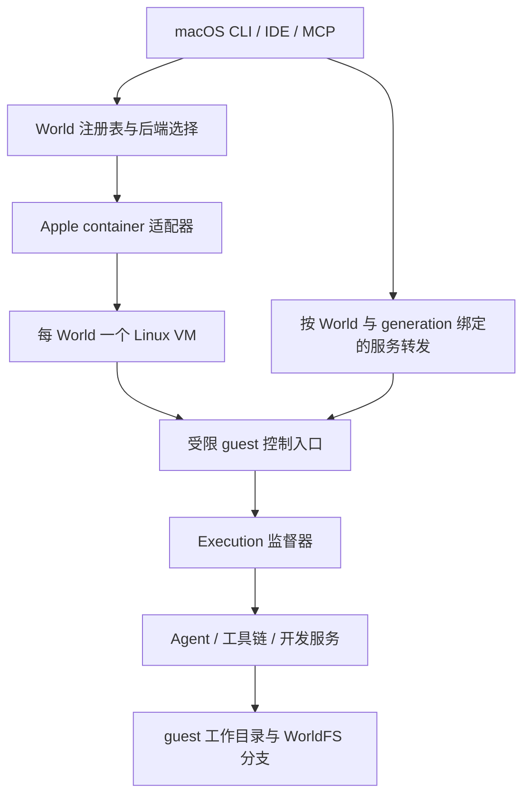

# macOS 宿主上的 Linux World

状态：设计与实验实现。决策日期：2026-10-25。已实现的范围见下节，其余章节仍是目标设计，不能当作已交付能力。本文定义用户明确选择 Linux 执行环境时的本地后端，与原生 macOS Workspace 并存。

## 当前实验实现

代码入口为 `crates/world-runtime/src/apple_vm.rs`、`guest/supervisor.py` 与 CLI 的 `--os` 选择。已实现：

- macOS / arm64 + 显式 `--os linux` 选择 VM，原生工作流保持不变；一个 World 一个 VM。
- create 保存配置和初始生命周期阶段；setup 创建/启动并检查 guest 协议与 cgroup.kill；show/list 返回配置、生命周期、provider 观测、时间和错误；exec 显式要求 ready；teardown 停机保留可写层；delete 仅删除已停机且归属匹配的 VM 实例与登记。
- 固定 container 1.6.1 和 Python/Alpine 镜像 digest，guest `/workspace`、UID/GID 1000、独立 cgroup v2、no_new_privs。argv/标准输入/退出码透传；正常结束、超时与取消均清理同一任务的后代，包括 setsid 后代。
- `workspace import <world> --source <host-directory>` 将宿主目录复制到空 guest `/workspace`。先以目录 fd 和 openat/O_NOFOLLOW 遍历，生成宿主磁盘上的有界流记录快照；guest 校验文件长度、结束标记、相对路径与父目录，拒绝 symlink 父目录、重复路径和特殊文件，暂存完成后原子替换空目录。导入与 exec/setup/teardown 使用独占锁互斥。源变化检测是尽力检查，源应暂停写入，不宣称一致性快照。
- 同一 VM 的并发 exec 共享 localhost，任务间取消独立。每个任务的结果保存于 guest `/var/lib/world/executions`；启动前向 stderr 输出随机 Execution ID，重试命令不复用已执行 ID。尚无公共 execution 查询/日志 API，断线时可能返回 unknown，不自动重放。
- 原生与 VM 记录共用原子注册表，原生条目保持旧格式，VM 条目标注 schema_version=2；首次加入 VM 前备份已有注册表。原生更新保留 VM 条目，重复名称禁止跨后端覆盖。旧二进制会因无法解析 VM 条目拒绝整个混合注册表；不能自动退回备份。

这是一版用于验证路径的实现，和下面目标设计的差距需要明确：

| 项目 | 当前行为 |
| --- | --- |
| 网络安全策略 | provider NAT，**尚不阻止宿主/LAN/跨 guest 出站**；show 明确返回能力 false；不支持严格出口策略 |
| 运行预算 | 每用户 setup 准入锁；除已运行的本 World 外，发现其他运行 container 即拒绝启动；不统计其他供应商 VM/machine，也未实现基于内存压力的准入 |
| 数据与镜像 | guest 普通可写层，无宿主挂载；固定基础镜像加 root-owned helper；支持独立 import 命令；无 export、创建时 --import、自定义镜像、WorldFS、分支合并 |
| 服务 | 使用仍在运行的前台 exec 承载服务；没有 named service、自动重启或宿主转发；普通 exec 结束会清理后台子进程 |
| 生命周期 | setup/teardown 与 exec 用文件锁互斥；teardown 遇活跃执行返回 busy，不能自动批量取消；已落盘阶段和启动 generation；尚无完整 Execution 恢复日志 |
| 协议 | 固定 helper 命令与独立 JSON 状态查询；不是完整 RPC/PTY/输出持久化协议；guest 控制进程故障后状态可能未知，需检查或停机 |
| 安全级别 | 实验性 VM 执行边界，不是设计中的受管安全后端；未交付的出口策略不会被描述为有效 |

导入保留内容、普通权限、可执行位和符号链接（包括悬空链接），移除 setuid/setgid/sticky 位，所有权设为 guest UID/GID 1000。隐藏文件和未跟踪文件默认包含；不保留时间戳、xattr、ACL、稀疏布局或硬链接关系。非 UTF-8 名称/链接目标、设备节点、FIFO、socket、超过 128 层的目录、超过一百万个条目及超过 4096 字节的相对路径明确失败。快照临时文件需要与源数据规模相当的宿主磁盘空间，传输记录有界，不将整个项目放入内存。guest 文件逐个 fsync，发布后同步父目录；不承诺磁盘崩溃下所有目录项的事务持久性。

取消信号在快照完成、传输开始前生效；传输开始后等待确定结果，上限 10 分钟，避免只关闭客户端就错误报告“未导入”。传输断线/超时返回结果未知，重试前先检查 `/workspace`；guest 的正常失败会清理暂存目录，VM 崩溃可能留下 `/var/lib/world/imports` 中的暂存数据，暂未自动回收。已有内容始终不自动覆盖。旧 VM 在无活跃 exec 时执行 setup，可原子更新 guest helper 后使用 import。

宿主本地用户仍能直接用 container 管理自己的 VM，这属于受信任宿主权限范围。旧记录不做全库 schema 转换；完整注册表/host identity/运行代际迁移后续再实现。OS 不匹配、provider 不可用或版本不兼容时拒绝 exec，不回退到宿主。

实际命令见 [README](../README.md#macos-上运行-linux-world实验性)。真实单 VM 回归用 `python3 experiments/macos/world_vm_smoke.py`：先 `cargo build --workspace` 并启动 container 服务；脚本建立 256 MiB VM，在临时目录记录结果，退出时停止并删除自己的实例，保留服务与镜像缓存。覆盖同名冲突、执行前置状态、stdin/argv、非零状态、后代回收、超时/取消、共享 localhost、独立任务取消、busy teardown、导入及重启持久化；导入覆盖跨块二进制内容、执行权限、相对与悬空链接、截断流、路径越界、symlink 父目录、特殊文件和覆盖拒绝。该测试只启动一个 VM，不声称完成跨 VM 网络策略验收。

## 已实现的生命周期管理

- `workspace list` 返回所有本地登记；原生记录标为 `unobserved`，不凭 loopback 地址推断进程存活。VM 的本地配置始终保留在查询结果中，provider/版本/归属校验失败返回 `unknown` 与 `observation_error`。
- `workspace show` 的 VM 状态区分 `created`（尚未创建实例）、`ready`（实例运行且本地最近一次 setup 验证完成）、`unverified`（实例存在但本地阶段尚未就绪/无法识别 provider 状态）、`stopped`、`missing`（此前已尝试创建/运行、现在确认不存在）和 `deleting`。ready 不是持续 guest 健康探测；exec 会再次握手。`lifecycle.phase` 返回最后持久化的操作阶段，`observed_at_unix` 是本次观测时间，generation 在每次尝试启动前递增，幂等 setup 不递增。
- 阶段记录按 instance owner 单独原子持久化，包含 created/provisioning/starting/ready/stopping/stopped/deleting。中断操作保留阶段用于后续检查；缺日志的旧记录视为 legacy，存在的实例可通过 setup 重新验证，缺失的实例不会被默认为从未创建。
- setup 发现旧运行时缺失或首次创建是否成功无法确认时拒绝隐式新建。只有 `--recreate-missing` 显式允许在确认实例不存在时创建空运行时；存在的实例始终复用，不能用该选项覆盖。此行为不提供旧文件恢复，forkfs 分支挂载由 #28 单独实现。
- teardown 保留注册和数据，不触发 WorldFS discard。活跃 exec/import 与其锁互斥，返回 busy，调用者应先取消执行。provider 不可用时不改写已知阶段；停止结果未知时保留 stopping，重试前重新观测。
- `workspace delete <name>` 要求没有活跃执行、provider 可查询，实例已 stopped/created，owner/image 匹配且 mounts 为空。有实例时必须指定 `--discard-runtime-data`，明确授权永久删除其可写层；尚未创建或确认丢失的实例可仅删除登记。原生 Workspace 暂不支持 delete。
- 删除先落盘 deleting，再删除 provider 实例，确认不存在后原子移除登记；任何 provider 错误保留登记，重复 delete 可完成收尾。deleting 阶段拒绝 setup/exec/import/同名 create。小型 journal/锁文件保留为 tombstone，避免旧句柄复活。所有操作取得锁后重新检查登记 owner，防止删除后同名重建的竞争。

运行时删除不调用 forkfs 分支删除。当前带挂载的实例直接拒绝删除，避免在 #28 挂载与卸载契约尚未落地时自动处理存储；该阶段后续扩展必须先释放挂载。尚未实现公共 Execution 查询/日志恢复、完整操作错误日志、跨 provider 恢复或自动 setup。

真实单 VM 回归追加验证：list、ready/stopped/created/missing/unknown 状态、幂等 setup 不推进 generation、重启推进 generation、删除运行 VM 拒绝、无数据删除确认拒绝、外部删除后的隐式重建拒绝与显式重建、删除 VM 保留同注册表原生记录，以及删除未创建实例的登记。单元测试覆盖 deleting 阶段防复活和同名替换后的旧句柄拒绝。

## 1. 决策与适用范围

**当 `execution_os=linux` 且 `host_os=macos` 时，选择 `apple-container`：一个 World 对应一个持久的轻量 Linux VM。** 用户选择操作系统，World 选择匹配且经过验证的执行后端。首版只支持 Apple Silicon 上的 Linux arm64；不隐式使用 Rosetta，不提供 Linux guest 内执行宿主命令的逃生通道。

| 宿主 | 用户选择的执行 OS | 解析结果 |
| --- | --- | --- |
| macOS / arm64 | linux | `apple-container`，一个 World 一个 VM |
| macOS | macos | 现有原生 Silo 兼容后端，保留其限制 |
| Linux | linux | 现有 Linux namespace 后端 |
| 任意宿主 | 未指定 | 新建时解析为宿主 OS 并持久化；不自动选择 Linux |
| Linux | macos | 拒绝，不以 Linux 冒充 macOS |
| macOS / Intel、Windows 或未支持组合 | linux | 首版明确不支持，不自动安装其他 VM 后端 |

“持久”指 Workspace 身份、磁盘与配置持久；VM 进程可以停止。每次 `exec` 复用该 World 的 VM，多次命令共享服务。首版不采用共享 VM 承载多个 World，也不为每条命令创建 VM。Xcode、Apple SDK 和原生 macOS 测试继续使用 macOS World。

本设计替代此前对所有 macOS 场景施加的“不依赖 Linux VM”约束。原生 macOS 的注入兼容性调查仍有效，但不阻塞 Linux World。

## 2. 实测依据与资源预算

[可重复探针](../experiments/macos/linux_vm_probe.py)和[2026-10-25 实测记录](../experiments/macos/linux_vm_probe_result_2026-10-25.json)来自 8 GiB Apple Silicon、macOS 27.0.1、Apple container 1.6.1、Linux 6.18.35、Alpine 3.22：

| 项目 | 结果与含义 |
| --- | --- |
| 配置 | 1 CPU、256 MiB 工作负载内存限额；不是宿主总占用上限 |
| 缓存齐全的创建启动 / 重启 | 0.616 / 0.517 秒，单次轻负载样本 |
| 宿主 physical footprint | VM 与专属 runtime 约 286 MiB；共享后台服务另约 26 MiB |
| 初始化成本 | 较早首次启动包含运行时初始化，耗时 21.388 秒；API server 历史内存峰值约 709.5 MiB |
| 已验证 | 多次 exec 访问同一 localhost 服务、重启保留文件、user/net/mount namespace 创建 |
| 未验证 | World 二进制、Agent、构建吞吐、pasta、完整隔离策略、forkfs、宿主端口转发 |

测量支持低成本单 VM 的可行性，不能据此推算十个 Agent 的成本。软件仓库下载未完成，不能把本次测试算作包管理网络验收。VM 重启后服务进程不恢复，需要重新启动。

产品初始默认拟定为 1 CPU、512 MiB 工作负载限额，允许用户显式设为 256 MiB 做小型任务；这些是产品预算，不是实测最佳值。8 GiB 宿主默认最多同时运行一个 Linux VM，其他 World 保持 stopped；达到上限返回资源不足，不停止已有 World，也不静默排队。提供宿主级并发上限配置和每 World 资源配置，扩容在停止后生效。

内存准入同时考虑配置限额、运行时余量及宿主内存压力，不把 macOS “free” 页面当作可分配容量，也不承诺硬性限制整个宿主物理占用。OOM 返回可识别的失败及 guest 证据；不能仅凭退出码 137 推断 OOM。首版不做自动扩容、热池或自动闲置停机，避免误杀后台服务。UI 分别显示工作负载限额、guest 用量与宿主占用，初始化下载峰值单列。

## 3. 用户接口与持久模型

以下展示目标接口：`--os`、`--cpus`、`--memory` 及基本生命周期已实现；`--import` 尚未实现：

```sh
# 新建空的 guest 工作目录；镜像由版本锁定的 World Linux 开发镜像提供。
world workspace create dev --os linux --cpus 1 --memory 512M
# 或显式将宿主目录导入为初始内容，不建立双向共享。
world workspace create app --os linux --import ./project --cpus 1 --memory 512M
world workspace setup dev
world workspace show dev
world exec dev -- uname -a
world exec dev -- sh -lc 'cd /workspace && make test'
world workspace teardown dev
```

- `--os` 取 `linux|macos`，创建时解析并持久化，执行时不能覆盖；改变 OS 必须新建 World 并显式迁移内容。
- 原生 Workspace 保留 `--workdir` 绑定已有宿主目录的语义。VM Workspace 使用固定 guest 工作目录 `/workspace`，拒绝 `--workdir`，以免同一参数暗中变成拷贝。`--import` 的宿主源路径只用于首次导入；不能在 guest 解释 `/Users/...`。
- VM 的 `create` 只登记配置及待导入源；`setup` 首次执行导入，成功前不接受任务。源可能变化，所以导入记录内容清单与实际完成 revision，后续 setup 不重新同步。需调用者保持源稳定，检测到变化时失败并重试，不承诺任意活跃目录的原子快照。
- `--image` 为后续高级选项；首版使用携带匹配协议版本的固定镜像 digest，不接受任意 OCI 镜像假装具有 World 管理能力。内核与 init 镜像也记录版本/digest，升级不自动替换已有 World 的运行契约。
- `setup` 幂等创建或启动；`exec` 要求 ready，不隐式下载、启动或变更 OS。`teardown` 仅停止此 World 的执行与 VM，保留可写层及工作数据；不调用全局 `container system stop`。
- `show` 返回期望配置与实际观测，至少包含宿主 OS、执行 OS/架构、后端、运行状态、generation、镜像/内核版本、资源限额、guest 路径、能力状态与观测时间。CLI 输出与 JSON 使用相同事实。

建议版本化 Workspace 记录：

```json
{
  "schema_version": 2,
  "id": "<stable-world-id>",
  "execution": { "os": "linux", "arch": "arm64" },
  "runtime": {
    "backend": "apple-container",
    "host_id": "<local-host-id>",
    "instance_id": "<provider-container-id>",
    "generation": 1,
    "image_digest": "sha256:<locked-image-digest>",
    "cpus": 1,
    "memory_bytes": 536870912
  },
  "storage": { "mode": "guest-managed", "workdir": "/workspace" }
}
```

示例仅展示核心字段；真实记录另含名称、desired/observed 状态、导入与 Operation 日志、协议版本、kernel/init 标识、能力探测结果及存储引用。host OS 是探测结果，不能信任用户自报。VM 后端不需要原生 `ip`/`temp_root` 字段，采用带标签的后端专属结构，不填假值。

现有 `silo::World` 使用 `deny_unknown_fields`，必须先引入显式 schema 版本与平台无关注册表，不能直接在旧 JSON 中追加字段。升级在锁内备份并原子迁移；缺少 OS 的旧记录按本机原生后端迁移，不转换成 VM。旧状态来源无法确定时拒绝自动迁移；原有 `--state-dir`、registry 身份、holder 与临时目录关联保持不变。旧二进制读取新版状态必须失败，禁止丢字段写回。跨宿主复制注册表不构成迁移。

## 4. 组件与执行路径



职责分为三层：

1. World 宿主侧管理身份、期望配置、幂等操作、后端选择、预算、端口发布和恢复。
2. Apple container 提供镜像、VM、网络设备与可写 rootfs 生命周期。首版适配固定兼容版本的 CLI，通过参数数组调用，读取 `inspect` 等结构化 JSON，不解析人类表格，不通过 shell 拼接命令。将供应商调用集中在一个模块，未来可替换为 Swift helper / Containerization API，公共接口不变。
3. guest 控制入口验证 World ID、generation 和协议版本，管理任务的退出状态、取消、输出及文件传输。控制通道首版通过 `container exec` 启动固定 helper，以 stdin/stdout 承载有长度上限的版本化消息；不用开放 TCP 管理端口。任务输出与协议帧分离，argv 不拼成 shell 字符串，用户环境不能覆盖管理身份。

宿主调用 `container exec` 的权限属于本地宿主信任边界；VM 中的普通任务不得获得控制凭证、管理 socket 或修改 helper 的权限。任务默认以非 root 身份运行，管理入口及状态受 guest 权限保护。缺少身份握手或版本不兼容时不执行用户命令。初始化与安装开发镜像依赖由受信启动过程完成，不默认赋予任务 sudo/CAP_NET_ADMIN。

未接入 forkfs 的本地运行时阶段，由 guest Execution 监督器执行命令，这是现有本地 Workspace 模式的 VM 扩展。接入第 10 节受管 forkfs 路线后，执行和存储锁的唯一所有者改为 guest 中的 forkfs RPC 服务；guest 控制入口仅承载/转接该 RPC，不再维护第二套 Execution。受管路径保持现有组织、Network、StoreBinding 与授权要求，不因 VM 在本机而降级为匿名执行。

不能把宿主 macOS 编译的 `world` 放进 guest 运行；发布 Linux arm64 的 helper/worker 与匹配开发镜像。一个 VM 已有独立内核与网络栈，首版无需再用 pasta 为 World 创建第二层网络。复用 Linux 进程监督与策略模块按能力进行，不直接嵌套整套 `silo::setup`。Agent 内层 sandbox 的网络 namespace 仍需单独验收。

## 5. 生命周期、执行与恢复

运行状态使用 `created → provisioning → stopped → starting → ready → stopping → stopped`，另有 `failed` 与 `unknown`。它与 WorldFS 的 ACTIVE/TRASHED 等存储状态独立，不把停机当作 discard。

| 动作 / 事件 | 契约 |
| --- | --- |
| 首次 setup | 锁定 World，探测宿主与版本、预留预算、准备镜像、创建实例、导入数据、启动并握手，验证所需策略后 ready |
| 重复 setup | 返回已有匹配实例，不新建 VM；同一 World 的并发 setup 串行化 |
| exec | 绑定 ready generation，分配 Execution ID；进程实际启动确认后才返回 started |
| 命令正常结束 | 记录退出码/信号并完成输出；VM 继续运行 |
| 取消 / 超时 | 终止对应 Execution 的受管进程集合并等待确认，不停止整个 World；取消受理不等于已经退出 |
| teardown | 阻止新执行，停止并确认所有任务及服务、撤销转发、停止 VM；保留磁盘和配置 |
| VM 崩溃 / 宿主重启 | 标记非 ready，旧执行不得推断成功；核对实例存活与日志后报告基础设施失败或未知 |
| 重连 | 对照 provider instance ID、World 标签和 generation；仅恢复原实例的查询，不重放用户命令 |
| 再次启动 | 增加 generation，握手后重新建立授权转发；文件保留，旧进程不复活 |

exec 传递 argv、guest cwd、白名单环境、stdin、超时和输出选项；保留非零退出码与信号。PTY、窗口大小和信号透传作为显式能力，未实现时拒绝相应请求。宿主的 PATH、HOME、SSH agent 和云凭证不自动进入 guest。

普通 exec 结束时清理其后代，避免后台进程失去归属。需要长期运行的开发服务使用拟议 `world service start <world> <name> -- <argv...>`，由同一 guest supervisor 持有独立服务 ID；后续 exec 可连接它。服务不会因启动 CLI 退出而停止，但 teardown 会停止它。实测探针中的后台 nc 仅证明跨 exec 网络与进程驻留机制，不代表正式产品已具备服务监督。

Execution 的启动幂等键、状态与必要输出落盘；连接丢失后可按 ID 查询。guest 使用每 Execution 的 cgroup/等效受验证进程集合管理后代，停止采用 TERM 加限时 KILL，覆盖 setsid 后代。若无法证明取消完成，报告未知并阻止破坏性存储操作，不能用 `container exec` 客户端退出推断任务退出。

创建和删除采用操作日志及带注册表身份的 provider 标签；崩溃后先查询再重试，仅回收本注册表拥有的实例。停止超时保留错误与数据，不擅自删除可写层。首版不新增“删容器即 discard”捷径；未来 discard/restore/GC 接入 WorldFS 的保留语义后，才允许回收对应存储。不得停止用户的其他 container、machine 或全局服务。

## 6. 文件、分支与 Agent 一致视图

活跃源码、依赖和构建输出默认在 guest 文件系统。第一阶段 `/workspace` 使用每 VM 独有的可写存储；这是普通持久目录，`fork/checkpoint/diff/merge` 未实现时必须报告 unsupported，不能把容器可写层称为 WorldFS。

宿主目录通过显式 import 进入 guest；导入不自动排除未跟踪文件或依赖。传输保留可支持的权限与符号链接，不跟随链接越出源目录，不接受设备节点或归档路径逃逸，报告不可支持的元数据及磁盘满。部分导入写入 staging，完成校验再发布，失败不留下可执行的半成品 Workspace。再次导入、导出均为显式操作，冲突不得覆盖宿主成果。

不默认共享宿主 HOME、仓库、Docker socket 或凭证。宿主 IDE 优先连接 guest 内远程服务，或使用受限文件读写接口；只将 shell 放进 VM、文件工具仍修改宿主源目录，不算完成 World 绑定。完整 Agent、LSP、MCP 子进程和开发服务应在同一 guest/分支内运行。宿主 Agent 委派模式只有在命令与文件工具都绑定同一 World 时才标为完整支持。

后续 WorldFS 接入通过既定 forkfs RPC。需要分支的源卷和目标卷必须具备已验证的克隆/快照语义；Apple 默认 ext4 rootfs 不能被假定具有 reflink，也不能直接把可写磁盘同时挂给两个 VM。数据布局优先采用每 World 独占数据卷，基线只读共享或经明确协议复制；实际存储方案要单独验证后再启用 fork。

fork 复制文件 revision、执行 OS、镜像和资源配置到新身份，不复制进程内存、监听 socket、凭证或待提交外部副作用。checkpoint 需停止写入者或由资源适配器提供一致性协议；磁盘拷贝不等于数据库一致性。每 World 独立 VM 使生命周期易于分离，但不会自动提供跨 World 合并。

## 7. 网络与隔离契约

同一 VM 内的任务与服务使用原生 localhost；不同 VM 可以使用相同端口。默认不发布宿主端口，不把 provider 分配的 guest IP 当作持久 World 地址。内核独立不代表 NAT 网络已阻止 guest 访问宿主、局域网或其他 guest。

首版目标策略是默认阻止 World 间及 guest 到宿主/局域网的主动连接，按显式出口策略允许互联网访问。由受信 guest 初始化配置 Linux 网络策略，任务不持有修改该策略的权限；受管部署若要求抵御 guest 内核失陷，还需要宿主/供应商侧边界，能力未验证则拒绝该安全级别。探测与真实拒绝测试成功前不标 ready。现有 `world network exec` 的出站白名单模式保持独立，不能因选择 VM 就声称已经覆盖它。 DNS、DHCP 等启动所需基础流量采用精确、可审计的例外；例如 provider 的宿主侧 DNS 地址只允许解析所需端口，不因此放开宿主网段。IPv4/IPv6、DNS 重绑定与到其他 guest 的直接 IP 路径都必须纳入拒绝测试。

拟议服务接口：

```sh
world service start dev web -- python3 -m http.server 8080 --bind 127.0.0.1
world service publish dev web --host 127.0.0.1 --port 18080 --target-port 8080
world service unpublish dev web
```

宿主 broker 监听明确的 loopback 端口，绑定 World ID 与 generation，经受限 guest 转发入口连接 guest localhost。不能只依赖 `container -p` 转发到 guest 网卡，因为仅监听 guest loopback 的服务未必可达。首版发布仅承诺 TCP，UDP 与 Unix socket 发布待单独适配；guest 内协议能力单独报告。

端口冲突明确失败，不自动改端口；默认禁止监听 `0.0.0.0`。转发是明确开放的双向应用数据通道，只允许连接指定 guest 目标，不提供 guest 任意访问宿主的隧道。停止、失联或 generation 变化立即关闭旧转发，重新握手后才能恢复，避免转发给复用 IP 的其他 VM。浏览器看到独立宿主端口，不能给多个 World 同时承诺相同宿主 URL。

## 8. 依赖、错误与交付顺序

首个已测版本组合为 macOS 27.0.1 / Apple Silicon / container 1.6.1；其他版本要通过兼容矩阵，不能把上游支持范围等同于 World 已验收范围。Apple 官方资料：[Containerization](https://opensource.apple.com/projects/containerization/)、[container 1.6.1 技术概览](https://github.com/apple/container/blob/1.6.1/docs/technical-overview.md)、[命令契约](https://github.com/apple/container/blob/1.6.1/docs/command-reference.md)。

setup 先检查架构、系统/API 能力、provider 版本与服务、镜像/内核缓存、磁盘空间和资源预算。普通执行不自动安装软件或修改全局 provider 配置。依赖缺失返回具体安装/启动指引；配置镜像可在明确 setup 过程中下载，离线有完整缓存时允许启动，离线缺失则失败。provider 版本超出已验收范围不能静默尝试或回退到宿主执行。

结构化错误至少区分 `unsupported_platform`、`runtime_missing`、`runtime_unavailable`、`version_mismatch`、`image_unavailable`、`resource_exhausted`、`import_failed`、`policy_unavailable`、`guest_handshake_failed`、`workspace_not_ready`、`execution_unknown` 与 `storage_unavailable`。错误保留重试条件和已完成阶段，不把启动基础设施失败变成命令成功。

实现按以下顺序推进，每一步独立标注已支持的能力：

1. **后端选择与注册表迁移**：从 `silo.rs` 提取平台无关 Workspace/registry；新增 `ExecutionOs`、带标签的 runtime 配置与 resolver，保留原生行为。`world-runtime` 新增后端接口和 `apple_container` 模块；CLI 增加 `--os` 与资源参数。此阶段还不开放未完成的 VM exec。
2. **单 VM 生命周期与执行**：锁定镜像与 guest 协议，完成 setup/show/teardown、状态对账、受管 exec/取消及出口策略；发布 Linux arm64 guest helper。达到下面的 MVP 门槛后才标为实验性可用。
3. **文件与开发体验**：交付安全 import/export、长期服务监督、宿主 TCP 发布和完整 Agent 文件/命令视图；补包管理与实际开发工具测试。导入接口只在本阶段通过后开放。
4. **WorldFS 与完整状态分支**：验证数据卷布局、forkfs RPC、fork/checkpoint/diff/merge/discard/restore，明确与数据库及副作用后端的能力组合。

MVP 验收必须包含：

- 显式 macOS-host/Linux-World 选择正确；未指定 OS 和旧记录保持原生；不支持平台与缺依赖绝不落回宿主执行。
- 并发 setup 只创建一个实例；命令 argv、退出码、stdin/输出、超时取消准确；客户端断连后不重放命令；VM 崩溃与宿主重启后可对账。
- 多次 exec 共享 localhost；服务与任务生命周期分离；重启保留文件、旧进程不复活；teardown 不影响非 World 容器。
- 两个 World 的同端口、跨 World 文件/网络隔离、宿主与 LAN 访问拒绝在容量足够的测试机验证；8 GiB 本机默认仅做一个 VM，不为验收强行超预算。
- 运行中与初始化阶段分别测内存、CPU、启动时间、停止后回收；预算不足和磁盘满时保留数据；OOM 与一般 SIGKILL 可区分。
- 版本不匹配、部分创建、数据导入失败、过期 generation、端口冲突及失联转发均有确定结果。各阶段尚未实现的能力必须明确拒绝。

当前实验实现仅覆盖本文开头列出的范围，不将探针或实验回归通过当作上述完整 MVP 已完成。
