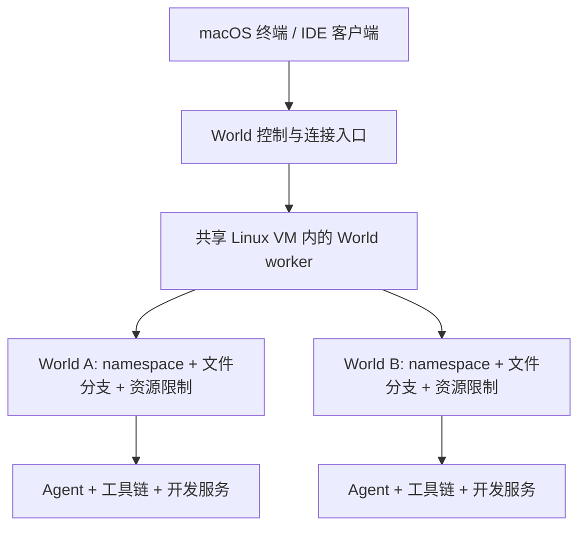

# macOS 执行后端重新评估

历史核查日期：2026-10-08。以下原始调研保留当时证据；2026-10-25 的路线更新见下节。依据官方文档、Apple 公开源码，以及 [本机 Agent 注入实测](macos-agent-chain-validation.md)。本轮没有安装、启动 VM 或 Network Extension，没有测得性能数字。文档中的方案是候选设计，当前实现仍为 Silo 与独立 Seatbelt 出站模式。

## 结论

**2026-10-25 更新：用户明确选择 Linux World、宿主为 macOS / Apple Silicon 时，采用每 World 一个 Apple 轻量 Linux VM 的设计。** 单个 256 MiB 工作负载限额 VM 已完成基础探针，随后交付实验性后端与单 VM 执行回归；完整网络策略及状态分支尚未实现；资源口径、接口和验收以 [Linux VM 后端设计](linux-vm-backend.md) 为准。此前“不依赖 Linux VM”的约束不再适用于 Linux World。

2026-10-08 的原生路线调查继续用于原生 macOS World：Claude 官方命令包装接口、受控工具链与 Network Extension 的组合见文末，命令包装入口已实测，完整透明网络与端口隔离尚未验证。下文共享 Linux VM 是历史对照，不是新选择的每 World 独立 VM 后端。

同时保留原生 macOS 需求这一独立维度。共享 Linux VM 不能执行 Xcode 或提供原生 macOS 测试结果。对于“任意原生 Mac 程序、完全不改配置、不同 World 独立 localhost 与相同监听端口”这一组合，本次未找到满足要求的受支持轻量公共 API。Silo 仅适用于可注入的完整进程链；原生 Mac VM 则是另一种成本更高的候选。

## 必须同时满足的网络语义

1. A/B 同时 `bind(127.0.0.1:3000)`，监听分别属于 A/B。
2. A/B 中的客户端访问同一 localhost 地址，分别到达各自服务。
3. 同一 World 的多次命令共享网络视图，服务生命周期不被一次命令退出意外终止。
4. `fork/exec` 后的工具、直接文件操作、MCP/LSP 等执行位置明确，不依赖主进程注入成功来推断。
5. IPv6、通配监听、UDP、Unix socket 分别验收；文件路径型 Unix socket 还需要文件视图隔离。

“按进程过滤出口”只涉及其中部分能力。服务的 bind 冲突发生在本地 socket 分配阶段；之后的数据包重定向不能自动把一个已经失败的 bind 变成独立监听。

## 原生轻量路线逐项复核

| 机制 | 可以承担的工作 | 对完整语义的缺口 | 建议 |
| --- | --- | --- | --- |
| Seatbelt / Agent sandbox | 按策略限制访问 | 未提供每 World 独立网络栈与监听端口空间 | 保留为安全执行能力 |
| Silo / DYLD interpose | 对受支持程序改写 bind/connect、临时路径 | 主程序及子进程必须兼容；本机 Claude 未采用注入请求 | 作为受限兼容后端 |
| loopback alias + 显式绑定地址 | 多服务复用端口号 | 程序必须绑定不同地址；硬编码 localhost 不会自动重写 | 可配置服务的轻量模式 |
| PF NAT/rdr、路由、utun | 包过滤、转发、隧道 | 不自动改变任意进程的 bind 语义，也不建立进程私有端口空间 | 作为出口/发布组件 |
| Network Extension 透明代理 | 不注入目标程序即可处理符合规则的 TCP/UDP 流 | 未找到通用 bind/listen 命名空间接口；loopback 与进程归属仍需验证 | 可研究流量路由，不能直接替代 namespace |
| 独立用户、chroot、launchd 域 | 身份、文件根或服务管理 | 不因此获得独立 IP 网络栈 | 不作为网络隔离后端 |
| socket-filter KEXT | 历史上可介入 socket 操作 | 相关 KPI 已被 Apple 列为不支持 | 不作为产品路线 |

**内核证据。** Apple 公开 XNU `in_pcbbind` 按现有 socket 地址/端口查重并返回 `EADDRINUSE`。这支持上述 bind 与包转发分层的判断。代码还出现 Skywalk `netns_reserve_*` 等内部名称，不能凭名称就认定有对外开放、可供 World 创建和加入的 Linux 式 namespace API。`SO_REUSEPORT` 也不自动按 World 将连接分发给各自监听者。[XNU 源码](https://github.com/apple-oss-distributions/xnu/blob/main/bsd/netinet/in_pcb.c)

**Network Extension 的边界。** Apple 提供 [透明代理](https://developer.apple.com/documentation/networkextension/netransparentproxyprovider) 与 [TCP/UDP flow copying](https://developer.apple.com/documentation/networkextension/handling-flow-copying)；本轮没有发现为任意未修改进程重定义 bind/listen 地址空间的公开接口。Apple 开发者论坛还有显式 loopback 规则未命中的报告，DTS 建议最小复现；该讨论没有最终通用结论，所以既不能断言 loopback 完全不可代理，也不能假设已可靠支持。[loopback 讨论](https://developer.apple.com/forums/thread/794776)

即使实现透明代理，两个运行相同 Claude 二进制的会话也需要准确的 World 身份映射。应用签名标识本身无法区分它们；进程及后代、代理自身的连接和生命周期必须有可验证的归属。若再叠加 Silo 解决服务端 bind，方案仍依赖服务进程可注入，不能扩大成任意原生程序保证。

**KEXT 不是捷径。** Apple 将 `sflt_register`、`sflt_attach` 等 Network Filter KPI 列为 macOS 11 起不支持。本轮不把降低系统安全配置或依赖私有内核接口列为日常开发者产品的前提。[Apple 弃用说明](https://developer.apple.com/support/kernel-extensions/)

## 对照方案：共享 Linux VM（当前不选作主路线）



完整 Agent 执行端应放在 guest，文件和服务使用同一 World 视图。只把 shell 放进去、主进程的文件工具仍在 Mac 上，不作为默认完整绑定方案。先复用 World Linux 的持久 namespace 机制，再补 mount/PID/身份/资源限制及适当安全后端；现有 namespace 代码不等于这些能力已经全部完成。

Linux namespace 在 guest 内由内核执行，无需对 Claude/Codex 注入动态库。不过 Agent 内层 sandbox 仍可能另建 network namespace，导致工具 localhost 与外层分离，必须实测。内层安全策略与外层身份/服务视图需要明确组合，不能以关闭所有限制来认定通过。

### 可复用的运行时

| 候选 | 已核实能力 | World 定位 |
| --- | --- | --- |
| Lima + VZ | Mac 上可用 Virtualization.framework；支持 VM 内容器与文件共享 | 首选开放、可配置的验证环境；明确只创建一个承载多个 World 的实例 |
| OrbStack | 官方架构是一台轻量 Linux VM，共享内核运行容器与 Linux machines | 可作现成后端/性能对照；需要核实集成接口及默认宿主访问能力 |
| Apple Containerization / container | 每个普通容器使用独立轻量 Linux VM | 对照更强的 VM 边界与每 World 成本，不混称共享内核方案 |

Lima 来源：[VM 类型](https://lima-vm.io/docs/config/vmtype/)、[容器](https://lima-vm.io/docs/examples/containers/)、[文件共享](https://lima-vm.io/docs/config/mount/)。OrbStack 来源：[架构](https://docs.orbstack.dev/architecture)，其普通 machines 默认信任宿主集成，不能直接作为恶意任务隔离保证。

Apple 的 [Containerization 概览](https://github.com/apple/container/blob/main/docs/technical-overview.md) 描述每容器 VM；2026 年的 [container machines](https://developer.apple.com/videos/play/wwdc2026/389/) 提供持久 Linux 环境，也仍以 VM 为基础。可以进一步评估一台 machine 承载多个 World，但这属于拟议组合，需要检查 guest 内核与权限，不能把发布说明当作 World 已兼容。namespace 不需要嵌套硬件虚拟化。

### 资源成本应怎样判断

粗略成本分解是“共享 VM 基础成本 + 各 World 的 Agent/服务工作集 + 文件缓存与管理成本”，对照“一 World 一 VM”的多份 guest 内核与基础系统。共享路线有减少重复基础成本的理由，但尚无本机数据证明具体节省多少。

- 2、5、10 个空闲 World 与同数量有 Agent、语言服务、数据库的 World 分别测量。
- 测宿主物理占用/内存压力、guest 工作集、空闲 CPU、冷/热启动、并行构建吞吐及停止后的内存归还。
- 区分配置内存上限与实际驻留；不能将配置为 2 GiB 直接当成固定消耗 2 GiB。
- Apple 当前分支文档指出 guest 释放页面不一定归还宿主，需专门测试高峰后的回收；其性能描述不等于本机实测。相关文档明确要求按发布 tag 核对版本。
- cgroup 配额、并发构建限额、空闲环境停止可作为控制手段，均需实现与验收。共享 guest 内核也意味着更大的故障共同影响范围。

## 两个不能被 VM 自动解决的问题

**文件分支。** 一台共享 VM 的磁盘快照会影响全部 World，不能直接实现单 World 的 fork/discard。因此共享路线仍需要目录/卷级分支管理。可以先采用现成后端验证，forkfs 保留候选地位；是否需要 FUSE/FSKit、自研 FS、在线数据库一致性，由明确语义决定，不因选择 VM 就整体删除。

优先将活跃构建目录和依赖放在 guest 原生文件系统，宿主通过远程编辑或显式成果导出访问。VirtioFS 可以用于共享，但双端同时写、文件监听、大小写和跨平台构建产物要单独处理；不能把宿主真实仓库直接读写挂载当成已经完成 fork。

**宿主访问服务。** 每个 World 内都能用 `localhost:3000`，不意味着普通 Mac 浏览器也能用同一个 URL 无歧义访问所有 World。需要独立域名、明确发布端口或指定 World 的转发入口。Lima 提供自动 localhost 转发，但它本身没有 World 身份语义，需配置为不产生未授权或冲突的发布。[Lima 端口转发](https://lima-vm.io/docs/config/port/)

## 原生 macOS 工作负载

需要 Xcode、Apple SDK 或 macOS 系统服务时，Linux guest 不能替代原生系统。选项是已验证的 Silo 工具链、允许地址配置的原生模式，或独立 macOS VM。共享一台 macOS VM 并不会让其内部突然具有 Linux namespace，因此也不能据此给多个原生 World 提供独立端口空间。

Apple 提供 macOS guest 的 [Virtualization.framework 示例](https://developer.apple.com/documentation/virtualization/running-macos-in-a-virtual-machine-on-apple-silicon)。运行状态恢复、磁盘克隆、数据库一致性、外部副作用以及跨机器可移植性是不同能力；不能从“支持 VM”推导全部已支持。本次没有选择原生 Mac VM 为默认后端。

## 历史验证计划：共享 VM 对照

1. 固定一版 Lima/VZ 与 Linux 镜像，探测 user/net/mount namespace、Landlock、seccomp、pasta 与 cgroup；建立一个共享 guest。
2. 在其中创建 A/B，运行 Linux 版 Agent，确认文件、命令和辅助进程归属；保持 Agent 自带 sandbox，记录真实嵌套结果。
3. A/B 同时运行相同端口的服务，分别经两次工具调用访问；同时验证 IPv6、UDP、Unix socket、禁止跨 World 访问与宿主发布。
4. 单独取消、停止、重启 A，不影响 B；停止整个 VM 后所有 World 报告失联及确定的恢复状态。
5. 与单独轻量 VM 路线比较相同任务和并发度下的资源使用，完成后再确定默认。

2026-10-08 原调查在本机 PATH 未找到 `container`、`docker`、`colima`、`limactl`；受当前执行环境限制，没有进行 VM 基准。此次结论是基于机制和公开实现的验证优先级，不是性能或兼容性验收。

## 原生方案继续调查：命令包装入口 + Silo + 透明代理

### 已实测的命令接入点

Claude 官方的 `CLAUDE_CODE_SHELL_PREFIX` 为 Bash、普通 shell hooks、status line 和 stdio MCP 启动命令提供 wrapper。它接收一个完整 shell 命令字符串；Bash 路径还包含 Claude 自己的 shell 启动和环境准备。PowerShell hooks、exec-form hooks 不经过这个 prefix。因此它不是任意进程或全部工具的安全边界。[环境变量契约](https://code.claude.com/docs/en/env-vars)

本机 Claude 2.1.292 用 `--init-only` 完成离线试验：

| 情况 | wrapper 观测 | hook 结果 | Claude 退出码 |
| --- | --- | --- | --- |
| wrapper 执行收到的命令 | 收到一个完整参数 | 写入预期标记 | 0 |
| wrapper 直接返回 125 | 仍收到完整参数 | 没有执行，也未观察到本地回退 | 0 |

这证明未注入的 Claude 可以主动调用我们的命令入口，也证明 `--init-only` 的成功不能作为 hook 执行成功的判据。此实验仅覆盖 SessionStart hook，不是模型驱动的 Bash，也没有开启 Silo 或网络代理。没有改动用户设置、签名或进行模型调用。

可重复探针见 [claude_shell_prefix_probe.py](../experiments/macos/claude_shell_prefix_probe.py)。它隔离配置与 HOME，编译临时 C wrapper，执行正反两组用例并保存结果：

```sh
python3 experiments/macos/claude_shell_prefix_probe.py --claude /Users/hurricane/.local/bin/claude
```

`CLAUDE_CODE_PROCESS_WRAPPER` 则针对 Claude 的自启动/后台进程，采用 argv 契约，与 shell prefix 不同。它可辅助生命周期登记，不能改变新 Claude 进程的 DYLD 加载权限。已有 daemon、外部启动和不同版本还有覆盖例外。[corporate launcher](https://code.claude.com/docs/en/corporate-launcher)

### SDK 给出了更明确的代理边界

本机 MacOSX27.0 SDK 的 `NetworkExtension.framework/Headers` 中：

- `NETransparentProxyNetworkSettings.h` 明确要求网络规则的 `matchDirection` 为 `NETrafficDirectionOutbound`，`matchLocalNetwork` 为 nil。不能由此构造任意 inbound bind/listen 接管。
- `NEFlowMetaData.h` 提供 `sourceAppAuditToken`。它为区分同一二进制的不同进程提供了身份材料，但仍要将进程实例绑定 World，处理 PID 重用、后代与后台会话；不能仅按 signing identifier 路由。
- `NEAppProxyProvider.h` 明确透明代理的 `handleNewFlow` 返回 NO 会直连原目标。实现不能在匹配到受管 World 但路由失败时用 NO 表示拒绝，必须正确终止该 flow。
- `usr/include/networkext/ne_socket.h` 公开的是域名和 attribution 设置，未提供 per-process network namespace。

这些是 SDK 静态证据；没有部署或运行 Network Extension。该部分需要带相应 entitlement 的扩展、系统激活，以及独立 loopback 和 audit-token 原型验收。

### 可验证的组合设计

1. World launcher 将未修改的 Claude 绑定到分支目录、World 身份和命令 wrapper。
2. wrapper 在命令执行边界选择受支持的非 SIP shell 与工具链，重新设置 Silo 注入；无需 Claude 主进程承载 Silo。
3. 可注入的服务与命令由 Silo 处理监听地址和 localhost。命令仍可使用原项目端口，不把“自动改项目配置”算作透明隔离。
4. Claude 主进程自身发起、且代理能捕获的 localhost 连接，按 audit token 对应 World 路由到该 World 的服务地址；正常模型连接另行处理。
5. Read/Edit 等文件操作使用分支目录，单独验证文件访问策略；网络代理不处理文件系统分支或路径型 Unix socket。

第 1 步中的 hook wrapper 调用已经实测；第 2～5 步作为组合尚未实现。没有说本机现有 `world exec` 已经支持这套链路。尤其外层/内层 Seatbelt、SIP helper、shell snapshot 和 stdio MCP 的真实命令封装顺序都需测试；不得用字符串替换所有 `/bin/sh` 或关闭原有 sandbox 来假装兼容。

### 原生路线的停止条件与支持范围

- 如果某个不可注入进程自己需要同端口监听，该组合仍不能保证它的 bind 被隔离。透明代理处理 outbound 无法补齐这一点。
- 不能假定 Claude 只发起连接：OAuth 回调、浏览器连接、后台服务及本地 IPC 的监听需求也要枚举；固定监听冲突未解决前不能标记完整支持。
- 没有注入的服务二进制、原始 syscall、从宿主 daemon 创建的进程，以及 prefix 以外的工具入口，都必须报告未覆盖或拒绝相应执行配置。
- Network Extension 若不能稳定捕获 loopback，或不能可靠区分 World，则不能宣称主进程网络透明。
- prefix 配置成功、CLI 退出 0、首个 ACK 成功都不是全链路验收。需要两 World、两次工具调用、服务持续存在、同端口不同返回值以及停止/故障测试。

### 其他线索的筛选

XNU 的 `INP2_EXTERNAL_PORT` 注释指向 NECP listener 的外部端口登记，`in_pcbbind` 的相关例外还比较 NECP client UUID；没有证据表明设置某个父进程开关即可使任意后代获得独立端口空间。它不能作为现成的 namespace 接口。参考 [in_pcb.h](https://github.com/apple-oss-distributions/xnu/blob/main/bsd/netinet/in_pcb.h)、[necp_client.c](https://github.com/apple-oss-distributions/xnu/blob/main/bsd/net/necp_client.c)。

也核对了原生容器项目 [osxiec](https://github.com/Okerew/osxiec)：文档展示 VLAN 和显式端口配置，并自行列出隔离及 Node 子进程限制。其容器/namespace 名称不是满足 World 透明同端口要求的证据，暂不作为替代后端；本轮未运行该项目。

当前最有价值的下一项实验是 **真实 Bash 工具 → wrapper → 非 SIP shell → Silo 服务**，同时独立验证 **两个进程 audit token → 两个 loopback 后端**。两条路径均通过后再组合，而不是先宣称已找到通用原生隔离方案。
